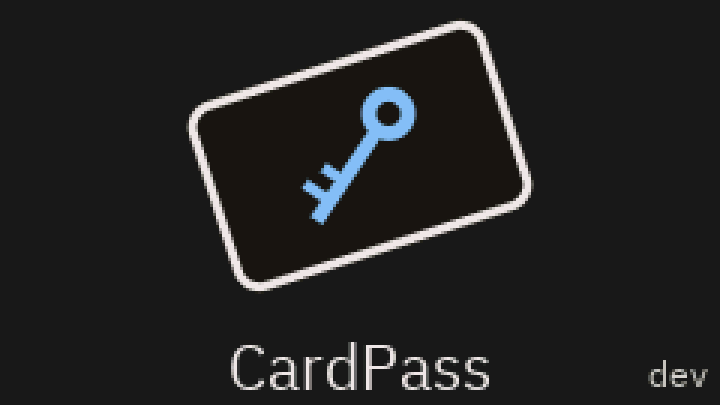
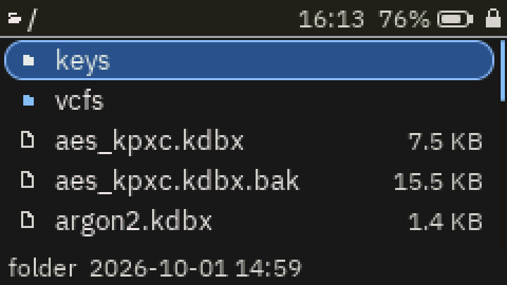
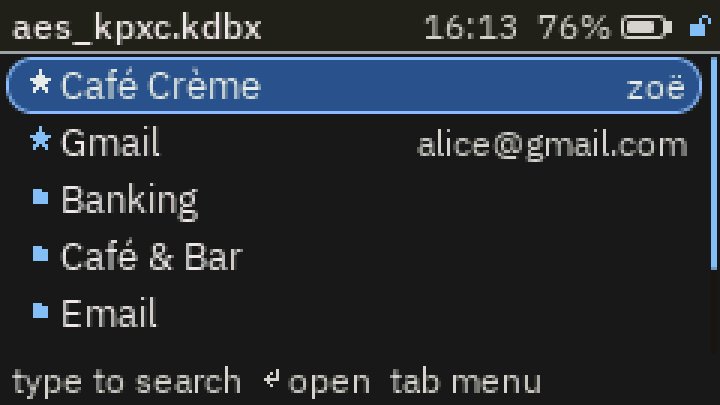
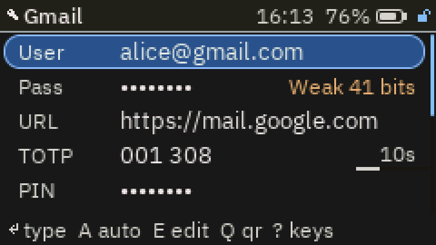
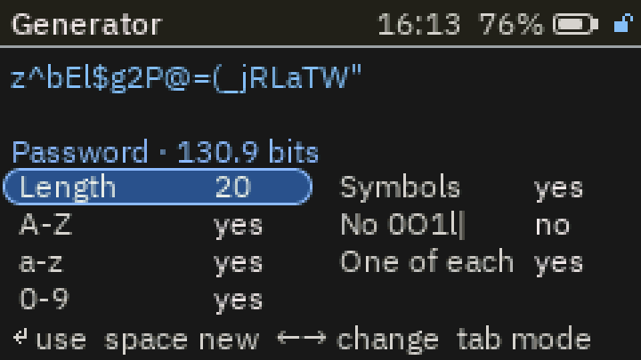
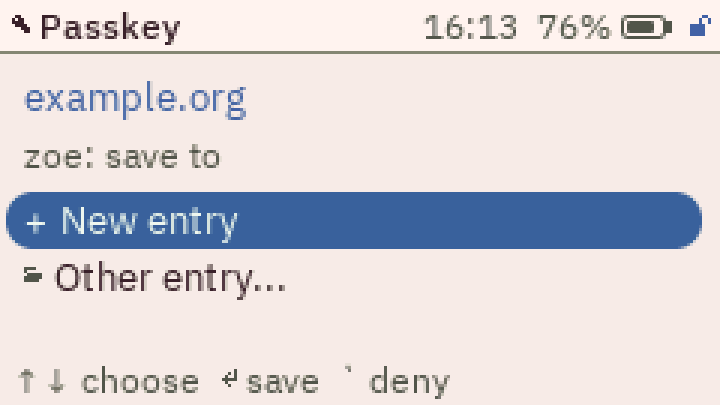

# CardPass

An offline KeePass (KDBX 4) password manager for the M5Stack Cardputer ADV and the original Cardputer (ESP32-S3, 512 KB RAM, no PSRAM).
It opens the same `.kdbx` files as KeePassXC and KeePass 2. Nothing is sent anywhere: no cloud, and Wi-Fi is only
used to set the clock while no database is open.

- Open, search, edit and save entries, create new databases (AES-KDF or Argon2id), key files, TOTP codes
- Type passwords into a PC or phone over USB or Bluetooth (keyboard layouts included)
- Passkeys: use KeePassXC-compatible passkeys as a USB security key, and register new ones on the device
- Browse the SD card, make/rename/delete folders, open VeraCrypt containers (AES + SHA-512)
- USB drive mode, password generator, password audit, panic lock (fn+L)

Guide: [docs/USER_GUIDE.md](docs/USER_GUIDE.md). Design and status: [PLAN.md](PLAN.md), [PROGRESS.md](PROGRESS.md).

## Screenshots

Rendered by the host UI test from the real UI code at the Cardputer's 240x135 size.

| | | |
|---|---|---|
|  |  |  |
|  |  |  |

## Install

One image runs on both the Cardputer ADV and the original Cardputer: it detects the keyboard at start-up. The ADV is the tested one; the original is untested on real hardware (reports welcome). On the original, a dead-battery deep sleep wakes with space, z, c, b, m, `.`, opt or the G0 button.


Build it (below) or take `CardPass.bin` (SD launcher) or `CardPass-full.bin` (M5Burner) from the releases page.

## Build

```
cd firmware && python -m platformio run
python tools/package.py          # -> dist/CardPass.bin, dist/CardPass-full.bin
```

Host tests (no hardware needed):

```
cmake -S tests/host -B tests/host/build -G Ninja
cmake --build tests/host/build && (cd tests/host/build && ctest)
```

## Security

Read this before trusting it with anything important.

- The database stays encrypted with your master password on the SD card. A long master password (and Argon2id) is
  what protects you if the card or the device is lost.
- The Cardputer has no secure element. While unlocked, the decrypted data is in the ESP32's RAM, and flash
  encryption / Secure Boot are deliberately not enabled so the firmware stays flashable. Someone who holds the
  unlocked device can do more than someone who only has the SD card.
- The code has had tests, fuzzing, AddressSanitizer runs and a self-review, but no independent audit.
- For high-value secrets (crypto wallets) use a hardware wallet such as a Ledger.

Found a problem? Please report it privately (see the repository's security tab) rather than in a public issue.

## Third-party code

mbedTLS and tinfl (ESP-IDF), yxml, Nayuki's QR code generator (`components/qr`), the EFF wordlist
(`components/gen`), IBM Plex fonts (`components/ui`). Their licenses are next to the code.
`firmware/components/esp_hid` is ESP-IDF's esp_hid with one fix, marked "CardPass".

## License

GPL-3.0, see [LICENSE](LICENSE). CardPass reads the KeePass file format but contains no KeePass code.

## Support

If CardPass is useful to you, you can support it on [Ko-fi](https://ko-fi.com/londhey).
